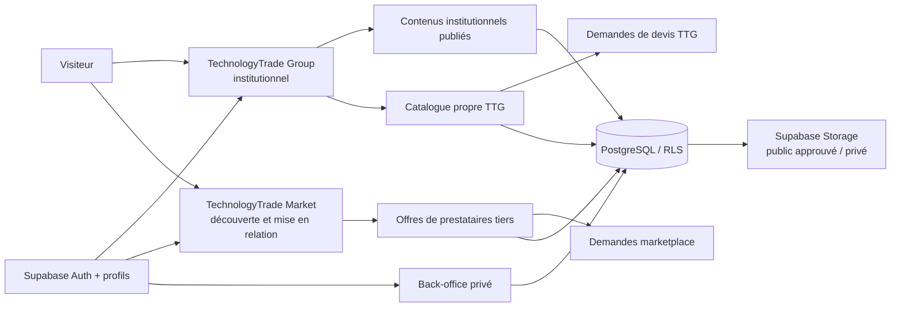
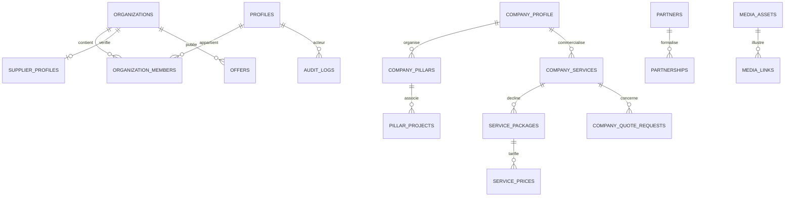

# TechnologyTrade Group — audit et architecture initiale

**État initial au 1er novembre 2026 — audit de cadrage préalable aux évolutions structurelles**

Ce document présente l'audit du socle existant, les constats vérifiables de l'étude comparative et une architecture cible proposée à cette date. Il ne vaut ni validation de tous les contenus institutionnels ni autorisation de publier des tarifs. La section ci-dessous actualise les faits d'exécution Supabase; le reste du rapport conserve le cadrage initial.

### État opérationnel Supabase (mise à jour au 1er novembre 2026)

Les deux migrations mentionnées dans ce rapport ont depuis été appliquées via l'éditeur SQL au projet `lfzxrsxhnrzezqdmejwe`. Le schéma initial compte 15 tables; la migration enterprise a ajouté 22 tables, toutes avec RLS activé. Une requête anonyme de contrôle confirme que `admin.access` est refusé et qu'aucun des neuf piliers brouillons n'est visible publiquement. La vérification a également confirmé l'absence de partenaires, services TTG ou tarifs fictifs. L'activation de RLS ne constitue pas à elle seule une validation des permissions avec plusieurs rôles.

La configuration locale est conservée dans `.env.local`, ignoré par Git. La garde de `/admin` distingue maintenant l'absence normale de session d'une erreur de vérification et redirige l'utilisateur non connecté vers `/espace-client/connexion`. Aucun compte `super_admin` n'a été attribué, aucune URL de production n'a été fournie, et les formulaires CRUD, workflows métier et tests d'accès multi-rôles restent à réaliser.

## 1. Résumé exécutif

Le dépôt contient un prototype Next.js largement construit à partir des maquettes institutionnelles, marketplace, client, fournisseur, administration et mobile. Le socle choisi est cohérent avec la mission : Next.js App Router, TypeScript, React, Supabase Auth et PostgreSQL avec politiques RLS. Une migration initiale, les parcours d'authentification et une migration additive de fondation préparée après validation du cadrage existent.

Le produit n'est toutefois pas encore un système d'information opérationnel :

- Aucun projet Supabase réel, fichier `.env.local` ni accès PostgreSQL n'est configuré dans l'environnement audité.
- Les routes de maquettes `/administration/...` restent illustratives. La route privée `/admin` vérifie maintenant la session et la permission côté serveur et affiche des compteurs réels limités par rôle, mais ne propose pas encore de gestion CRUD.
- Les données institutionnelles, les domaines, les prix et les statistiques présentés par le prototype ne sont pas un CMS relié à la base.
- L'architecture de marque confirme les neuf noms et leur ordre, mais pas les descriptions détaillées, les objectifs ni les contenus publiables.
- Le prototype n'est pas encore relié aux modèles séparés pour les services propres TTG et les offres de fournisseurs tiers; une migration additive les prépare.

**Recommandation :** conserver le stack et les routes validées, confirmer les données et permissions de l'entreprise, puis faire évoluer le schéma par migrations additives. Aucune migration existante ne doit être réécrite après sa mise en service. Les paiements, commissions, données de direction et documents internes restent hors publication jusqu'aux validations nécessaires.

## 2. Périmètre et méthode de l'audit

L'examen a porté sur l'inventaire des routes App Router, les dépendances et scripts, le README, les pages et composants institutionnels représentatifs, les routes d'administration, les actions Auth, la configuration Supabase, les types TypeScript, la migration SQL, les tests existants, les maquettes disponibles et les documents Word présents dans le dépôt.

L'étude est architecturale et ciblée : elle ne prétend pas être une revue ligne par ligne de chacun des écrans, ni un audit de sécurité complet. Les sites de référence ont été consultés le 1er novembre 2026 avec les pages officielles indiquées ci-dessous. Lorsqu'une page n'était pas accessible, aucune conclusion fonctionnelle n'en est tirée.

## 3. État technique constaté

### Technologies et scripts

| Élément | État observé |
|---|---|
| Application | Next.js 16 App Router, TypeScript, React 19 |
| Runtime observé précédemment | Node.js 24, npm 11 |
| Authentification / données | `@supabase/ssr`, `@supabase/supabase-js` |
| Base prévue | Supabase/PostgreSQL 17, d'après `supabase/config.toml` |
| Validation | `npm test`, `npm run lint`, `npm run typecheck`, `npm run build` |
| Paiement | Aucun prestataire ni flux de paiement réel configuré |
| Fichiers | Ressources statiques dans `public`; pas de médiathèque métier connectée |

### Écrans et parcours

Les routes couvrent le site institutionnel, le marketplace, les demandes, les espaces client et fournisseur, les opportunités, les ressources, les états d'interface et 13 routes d'administration. Les maquettes desktop des dossiers 01 à 09 et les maquettes mobiles du dossier 10 sont présentes. Les tests existants contrôlent de nombreuses routes et navigations.

Les écrans de maquettes utilisent des chemins `/administration/...` existants. La route dynamique les rend via `AdminAndStatePages`; ils restent des démonstrations non privilégiées et ne deviennent pas privés par leur nom. La nouvelle route `/admin` est distincte : elle contrôle l'utilisateur avec Supabase Auth et appelle `has_admin_permission('admin.access')` avant de rendre son tableau de bord. Chaque indicateur vérifie également sa permission métier et lit un compte exact soumis aux politiques RLS. En l'absence de configuration, migration ou droit vérifiable, la page bloque les données et présente un état explicite.

### Socle Supabase déjà préparé

La migration `supabase/migrations/20261101170000_initial_backend.sql` crée 15 tables :

`profiles`, `organizations`, `organization_members`, `supplier_profiles`, `platform_admins`, `categories`, `offers`, `service_requests`, `request_supplier_matches`, `quotes`, `opportunities`, `opportunity_applications`, `content_items`, `notifications` et `audit_logs`.

Elle contient des contraintes, des index, des fonctions et déclencheurs, des rôles plateforme, une vue publique de fournisseurs vérifiés et des politiques RLS sur les tables applicatives. Les inscriptions Auth peuvent provisionner un profil et une organisation. Les actions serveur fournissent inscription, connexion et réinitialisation de mot de passe; `proxy.ts` prépare la synchronisation des sessions.

Après accord sur l'architecture et identification de la planche de marque, `supabase/migrations/20261101190000_enterprise_foundation.sql` a été ajoutée. Elle crée 22 tables supplémentaires pour les permissions d'administration, le profil institutionnel, les neuf piliers en brouillon, les partenaires, les médias, les services propres à TTG, leurs prix, les demandes de devis et les devis TTG. Chaque table nouvelle active RLS. Les services TTG sont distincts des offres `offers` des fournisseurs. Aucun service, partenaire, tarif ni contenu institutionnel fictif n'est inséré; seuls les noms de marque établis de la planche sont préremplis comme piliers non publiés.

La migration ajoute les permissions de lecture, modification, publication et approbation tarifaire, les déclencheurs de publication avec revue, et un journal d'audit qui consigne les noms de champs modifiés sans copier les valeurs sensibles. Les rôles sont définis mais aucun compte interne n'est attribué par défaut. Les auteurs de contenus sont liés à l'utilisateur authentifié dans les déclencheurs de publication. Les métadonnées des médias sont privées par défaut. La garde de `/admin` et le tableau de bord à compteurs permissionnés sont implémentés; les imports, les buckets Supabase Storage, l'espace de gouvernance/chronogramme et les formulaires CRUD restent à réaliser.

**Limite importante :** l'existence de ces fichiers ne prouve pas qu'ils fonctionnent sur une base distante. Les variables publiques Supabase sont documentées dans `.env.example`, mais aucun projet n'est relié. Le poste audité ne dispose pas de `psql`, Docker ni Supabase CLI. Les migrations, politiques et flux Auth n'ont donc pas été exécutés contre PostgreSQL/Supabase.

### État Git et protection des contenus

Le dépôt possède le remote `origin` vers `technologytradegroup/site-TechnologyTrade-group`. La branche `main` est basée sur `b157ca6` au moment de l'audit. Le répertoire de travail comporte des modifications backend non commitées ainsi que des dossiers tarifaires et livrables non suivis. Ils doivent être préservés; les documents tarifaires ne doivent pas être publiés par inadvertance. Ce rapport ne publie aucun tarif et aucun secret.

### Vérifications disponibles

À la reprise, les 33 tests, ESLint, TypeScript et un build de production Webpack isolé avaient réussi; l'endpoint local `/administration/tableau-de-bord` répondait HTTP 200. Après l'ajout de `/admin`, les 41 tests, ESLint, TypeScript et un nouveau build de production Webpack isolé passent. Le build a listé `/admin` comme route dynamique. Ces résultats valident le code et les contrôles statiques, **pas** la migration PostgreSQL, les autorisations réelles, un déploiement Supabase ou la confidentialité des fichiers.

## 4. Données institutionnelles : ce qui est connu et ce qui ne l'est pas

La planche de l'[architecture de marque](../../Architecture_de_Marque/TTG_Architecture_de_marque_planche.png) confirme les neuf noms de marque et leur ordre visuel. Le composant `components/GroupPresentation.tsx` fournit les libellés français actuellement associés :

| Ordre | Nom officiel affiché dans l'architecture de marque | Libellé français existant dans le prototype |
|---:|---|---|
| 1 | Software | Logiciels et applications |
| 2 | AI | Intelligence artificielle et données |
| 3 | Cloud | Cloud et infrastructures |
| 4 | Cyber | Cybersécurité |
| 5 | Academy | Formation et compétences |
| 6 | Labs | Recherche et innovation |
| 7 | Capital | Financement et investissement |
| 8 | Market | Marketplace |
| 9 | Foundation | Impact et ONG |

Cette source confirme l'identité visuelle et l'ordre des neuf entités. Elle ne contient pas les descriptions institutionnelles détaillées, objectifs, projets associés ni règles éditoriales demandés. Les libellés français sont le contenu existant de démonstration, à confirmer avant d'en faire les intitulés institutionnels définitifs.

Le prototype affiche également des chiffres de démonstration (par exemple pays représentés et fournisseurs vérifiés). Ils ne sont pas alimentés par la base et ne doivent pas être présentés comme des indicateurs réels.

Deux fichiers de portraits existent dans `public/members` et sont utilisés dans les écrans institutionnels. Leur présence dans le dépôt ne vaut pas confirmation de fonction actuelle, d'autorisation de publication ou de droits d'image.

## 5. Étude comparative — constats vérifiables

Cette étude extrait des principes d'organisation, de confiance et de parcours des pages publiques consultées. Elle ne recommande pas de copier leur identité graphique, leurs textes ni leurs interfaces.

### Sites institutionnels et groupes

| Référence officielle | Observation constatée sur la page consultée | Principe retenu pour TTG |
|---|---|---|
| [Microsoft — About](https://www.microsoft.com/en-us/about) | La page récupérée met en avant des valeurs d'entreprise explicites. | Présenter les valeurs et engagements comme des contenus éditoriaux vérifiables, non comme des slogans disséminés. |
| [IBM — About](https://www.ibm.com/about) | La page combine ce que l'entreprise fait, ses activités, des repères, son leadership et son histoire. | Relier la présentation institutionnelle aux activités concrètes et à des preuves, sans afficher de chiffres non vérifiés. |
| [Accenture — Company](https://www.accenture.com/us-en/about/company-index) | La page organise le discours autour de la valeur pour plusieurs parties prenantes et traite aussi d'éthique et de responsabilité. | Distinguer proposition de valeur, publics concernés, gouvernance et engagements. |
| [Deloitte — About](https://www.deloitte.com/global/en/about.html) | La page présente impact, personnes/leadership et éthique dans des sections séparées. | Rendre la gouvernance et l'éthique directement accessibles, au lieu de les enfouir dans une page générique. |
| [World Bank Group — About](https://www.worldbank.org/en/about) | La page récupérée associe mission, enjeux, portée géographique et accès au leadership. | Commencer par une mission claire, puis donner accès aux réalisations et aux responsables réellement confirmés. |
| [Google — About](https://about.google/) | La page récupérée expose l'actualité récente et une entrée « Google around the globe ». | Prévoir des entrées éditoriales et géographiques, sans déduire d'autres fonctions non observées. |
| UNDP | Les URL officielles testées ont répondu HTTP 403 lors de la consultation. | Aucune caractéristique propre à UNDP n'est attribuée dans cette étude. |

### Marketplaces et commerce

| Référence officielle | Observation constatée sur la page consultée | Principe retenu pour TTG |
|---|---|---|
| Upwork | La page officielle testée a répondu HTTP 403. | Aucun mécanisme Upwork n'est présenté comme vérifié. |
| Fiverr — [accueil](https://www.fiverr.com/) | La page récupérée s'adresse aux clients de freelances et affiche un accès par catégories (700 catégories annoncé sur la page). La route « how it works » testée n'était pas disponible. | Commencer par le besoin utilisateur et une découverte par catégorie; ne pas transformer un chiffre de la page en indicateur TTG. |
| Malt | La page officielle testée a répondu HTTP 403. | Aucun mécanisme Malt n'est présenté comme vérifié. |
| Alibaba — [accueil](https://www.alibaba.com/) | La page récupérée expose une taxonomie de catégories produits et services. | Utiliser une taxonomie compréhensible et une recherche qui ne révèle pas l'organisation interne du groupe. |
| Amazon Business — [site officiel](https://business.amazon.com/en) | La page récupérée met en avant l'achat professionnel et des entrées de sélection commerciale. | Concevoir le parcours B2B autour de l'approvisionnement et du besoin professionnel, distinct d'une vitrine institutionnelle. |
| Shopify — [About](https://www.shopify.com/about) | La page récupérée met en avant des outils opératoires de commerce : checkout, analytique, livraison, marketing, paiements et support. Shopify est une plateforme marchande, pas un équivalent exact de marketplace de services. | Garder les fonctions opérationnelles (devis, demandes, suivi) séparées des contenus d'entreprise. Aucun paiement TTG n'est à activer sans décision dédiée. |

### Synthèse UX

- Conserver deux entrées immédiatement lisibles : **TechnologyTrade Group** (entreprise, vision, piliers, gouvernance, partenaires) et **TechnologyTrade Market** (recherche, offres, prestataires, demandes).
- Partager marque, compte et composants accessibles, mais donner au Market ses propres navigation, filtres, fiches et appels à l'action.
- Garder le menu institutionnel court; exposer les rubriques profondes via menus contextualisés et fil d'Ariane.
- N'afficher des indicateurs, partenaires, profils, tarifs ou validations que lorsqu'une donnée réelle et une autorisation le justifient.
- Préserver les parcours mobiles fournis et tester claviers, erreurs de formulaires, contraste et états vides avant de déclarer les parcours opérationnels.

## 6. Architecture cible proposée

### Deux univers, un socle partagé

Le site public existant et ses URLs restent la référence de compatibilité. Les routes actuelles du marketplace et les maquettes d'administration sont conservées; `/admin` est le nouvel espace privé séparé. Aucun lien public vers cette route n'est ajouté.

### Domaine et dictionnaire de données cible

Le schéma ci-dessous décrit la cible logique par **migrations additives**. La migration de fondation a été exécutée sur le projet mentionné ci-dessus. Les modules de gouvernance, chronogramme, réunions, documents internes et commandes marketplace restent à concevoir et migrer.

| Domaine | Entités proposées | Relations principales et règles |
|---|---|---|
| Identité et accès | `profiles`, `organizations`, `organization_members`, `platform_admins` (extension graduelle par permissions) | Un utilisateur appartient à une ou plusieurs organisations; les rôles plateforme sont distincts des rôles d'organisation. |
| Entreprise | `company_profile`, `company_history`, `company_values`, `company_objectives` (préparées); `company_activities` et publications enrichies (à venir) | Contenu institutionnel avec état brouillon/en révision/publié/archivé, dates et audit. Une seule fiche de profil active, si le modèle mono-entreprise est confirmé. |
| Piliers | `company_pillars`, `pillar_projects` (préparées) | Noms et ordre officiels préremplis en brouillon; descriptions, objectifs, médias et projets doivent être confirmés avant publication. |
| Direction et gouvernance | `executive_profiles`, `organization_units`, `leadership_roles`, `management_activities`, `management_tasks`, `management_decisions`, `meeting_participants`, `meeting_reports` (à venir) | Informations internes séparées des champs publics; activités et documents soumis à permissions restreintes et audit. |
| Partenaires | `partner_categories`, `partners`, `partnerships` (préparées); documents de partenariat (à venir) | Une fiche n'est pas publique par défaut; confirmation de relation, autorisation de marque et permission de publication sont requises. |
| Médias et fichiers | `media_assets`, `pillar_media` (métadonnées préparées); stockage et flux d'import (à venir) | Stocker en base les métadonnées et chemins, pas les binaires. Les médias sont privés par défaut; aucun bucket ni import n'est encore configuré. |
| Services propres TTG | `company_service_categories`, `company_services`, `service_packages`, `service_prices`, `service_options` (préparées) | Propriétaire séparé des offres tierces, cycle de publication et prix approuvés; aucun tarif n'est prérempli. |
| Demandes commerciales | `company_quote_requests`, `company_quotes` (préparées) | Référence unique, demandeur, service, budget et statut; l'insertion publique, les pièces jointes, les interactions et notifications nécessitent encore un flux sécurisé. |
| Marketplace tiers | `offers` existante, `service_requests`, `request_supplier_matches`, `quotes` existantes; plus tard `orders`, `reviews`, `disputes` | Les offres demeurent rattachées à l'organisation fournisseur. Une commande, commission ou transaction n'est pas simulée comme opération réelle. |
| Éditorial et exploitation | `content_items`, `notifications` et `audit_logs` existantes; nouveaux rôles et audit de fondation préparés; `system_settings` ultérieure | Publication et rôles séparés; l'audit de fondation consigne les champs modifiés sans enregistrer leurs valeurs. |

Ce diagramme est conceptuel. Les relations polymorphes génériques doivent être évitées quand elles empêchent les clés étrangères : préférer des tables de liaison explicites par domaine, ou une conception contrainte et documentée.

### Publication, accès et fichiers

- Chaque table publiée possède un statut et les règles de transition associées. La création ne vaut pas publication.
- Les politiques RLS limitent les lignes selon le rôle et le périmètre; les actions serveur contrôlent aussi les permissions avant chaque écriture.
- Une permission d'administration n'est jamais accordée à l'inscription publique. L'affectation initiale du super-administrateur reste une opération de déploiement contrôlée.
- Les rôles préparés dans la migration n'ont aucun compte attribué par défaut. Confirmer les périmètres organisationnels avant d'attribuer ces rôles.
- Les documents de direction, finances, juridique et les médias non validés utilisent un stockage privé. Les pages publiques ne reçoivent que les références de médias explicitement approuvés.
- Les traces d'audit identifient l'acteur, l'action, la cible et l'horodatage; elles ne stockent ni mots de passe, ni jetons, ni contenu documentaire confidentiel.

### Distinction commerciale obligatoire

Le modèle actuel `offers` est rattaché à une organisation fournisseur. Il convient aux offres de tiers, pas au catalogue direct de TechnologyTrade Group. La cible sépare donc `company_services` et `offers` plutôt que de coder un propriétaire implicite dans un champ libre.

Les grilles tarifaires présentes contiennent des propositions provisoires à valider. Elles ne doivent être importées comme prix publiés qu'après approbation écrite. Toute conversion de devise reste une référence indicative tant que la direction ne l'a pas confirmée. Paiements, commissions, commandes et remboursements attendent la validation du modèle juridique et du prestataire.

## 7. Rôles et périmètre de permissions proposé

| Rôle proposé | Accès fonctionnel minimal | Exclusions par défaut |
|---|---|---|
| Super-administrateur | Configuration et attribution des permissions | Secrets jamais affichés dans l'interface |
| Direction | Contenus institutionnels, gouvernance, activités et synthèses autorisées | Pièces financières/juridiques sans autorisation explicite |
| Communication / éditorial | Contenus, médias publics, prévisualisation et soumission à validation | Documents internes, utilisateurs, finances |
| Commercial | Catalogue TTG, tarifs autorisés et demandes de devis | Administration des comptes et documents de direction |
| Gestionnaire partenaires | Fiches partenaires, validations et médias de partenariat | Finance et documents confidentiels |
| Modération marketplace | Fournisseurs, offres et signalements selon périmètre | Catalogue propre TTG, finance, gouvernance |
| Analyste | Indicateurs calculés sur données réelles et minimisées | PII et écriture de contenu |
| Membres/clients/fournisseurs | Données propres à leur compte et à leurs organisations selon rôle | Données d'autres comptes et toute donnée d'administration |

Ce tableau est une base de discussion et ne préjuge pas des postes occupés. Les contrôles côté serveur et RLS doivent appliquer le même périmètre; masquer une action dans l'interface ne constitue pas un contrôle d'accès.

## 8. Phasage recommandé et critères de vérification

1. **Confirmer les données et décisions** : les noms des neuf piliers et l'architecture sont établis; les autorisations, rôles, périmètres et tarifs doivent encore être validés.
2. **Valider les migrations additives** : le schéma a été appliqué sur le projet lié; il reste à faire une validation d'accès et de workflows avec plusieurs comptes.
3. **Étendre le back-office sécurisé** : la garde de `/admin` et des compteurs permissionnés existent; connecter les formulaires, valider les refus d'accès et contrôler chaque écriture par permission et RLS.
4. **Rendre administrables les contenus institutionnels** : prévisualisation, validation, publication et dépublication; aucune donnée fictive en production.
5. **Connecter services et devis TTG** : tarifs versionnés, référence de demande, notifications et pièces jointes protégées.
6. **Étendre le marketplace par étapes** : ne pas confondre fournisseurs et entreprise; orders/reviews/disputes seulement lorsque règles métier et légales seront approuvées.
7. **Valider le déploiement** : appliquer migrations sur un projet de test, vérifier RLS avec plusieurs rôles, parcourir Auth, uploads, publication, formulaires, liens, responsive et accessibilité.

Pour chaque phase, les critères minimaux incluent migration exécutable, tests automatisés, vérification des accès autorisés et refusés, absence de fuite de données, état d'erreur visible et compatibilité avec les routes existantes.

## 9. Risques et blocages actuels

| Risque ou blocage | Conséquence | Réponse requise |
|---|---|---|
| Aucun compte d'administration n'est encore attribué | `/admin` reste réservé et les indicateurs métier sont indisponibles | Inscrire puis confirmer le compte autorisé, puis accorder le rôle depuis l'éditeur SQL après confirmation de son e-mail. |
| RLS exécuté mais non testé avec plusieurs comptes | Les frontières réelles entre permissions ne sont pas encore validées en usage | Tester les refus et autorisations avec des comptes séparés avant production. |
| Migrations appliquées manuellement, sans passage CLI vérifié | L'historique de migrations Supabase CLI n'a pas été vérifié; un `db push` non préparé peut tenter de rejouer le schéma | Avant toute utilisation CLI, inspecter/aligner l'historique de migrations et ne pas rejouer les scripts sur la base existante. |
| Modules CRUD et workflows métier absents | `/admin` fournit les accès et compteurs mais ne pilote pas encore l'activité | Implémenter les formulaires/actions par permission, avec audit et politiques RLS. |
| Fonctions et responsabilités de direction inconnues | Risque d'attribuer un poste ou d'exposer une personne sans accord | Confirmer noms, fonctions, biographies et autorisations de publication. |
| Droits de publication des partenaires et photographies non confirmés | Risque juridique et réputationnel | Obtenir confirmation d'utilisation des noms, logos et images avant publication. |
| Tarifs marqués provisoires | Risque de présenter une proposition comme offre officielle | Validation de la grille, des devises, taxes et conditions par la direction. |
| Stockage, conservation et suppression des documents non décidés | Risque de fuite ou de conservation excessive | Définir accès, catégories, taille, types, durée, sauvegarde et suppression. |
| Paiement et commission non définis | Risque réglementaire et contractuel | Ne pas activer paiement ni prélèvement automatique à ce stade. |
| Plusieurs fichiers source non suivis/modifications en cours | Risque de publication ou d'écrasement involontaire | Vérifier le périmètre avant chaque commit; garder les documents tarifaires locaux. |

## 10. Informations attendues de la direction

1. Les neuf piliers : les noms et l'ordre visuels sont confirmés par l'architecture de marque; fournir les descriptions, objectifs, projets associés et libellés français approuvés.
2. La fiche entreprise officielle : nom légal, pays d'enregistrement, adresse et coordonnées publiques, historique, mission, vision, valeurs et domaines confirmés.
3. La direction et la gouvernance : noms, fonctions effectivement occupées ou vacantes, biographies validées et dates de prise de fonction.
4. Les photographies : personnes représentées, autorisations, légendes, textes alternatifs et statut public/privé.
5. Les partenaires : partenaires confirmés, catégorie, description de la relation, période et autorisation d'utiliser leur nom/logo.
6. Le catalogue des services que TTG vend directement, les catégories validées, leurs livrables et la grille tarifaire officiellement approuvée.
7. Les rôles internes et leurs périmètres, notamment l'accès aux pièces financières, juridiques et stratégiques.
8. La politique de documents et de fichiers : durée de conservation, suppression, sauvegardes et accès.
9. Le cadre commercial et juridique avant d'introduire commandes, paiements ou commissions.

## 11. Suite proposée

Ce rapport documente l'audit initial et son évolution. Les migrations sont maintenant appliquées sur le projet Supabase indiqué, la connexion locale fonctionne, et `/admin` est protégé par Auth et permission serveur. Les piliers restent en brouillon jusqu'à approbation de leurs textes. Le domaine Vercel communiqué est configuré comme URL du site et de redirection dans Supabase Auth; les trois variables publiques requises sont configurées pour l'environnement Production Vercel. Le compte proposé pour le rôle super-administrateur n'apparaissait pas dans la liste des utilisateurs au dernier contrôle et l'invitation n'a pas été confirmée comme envoyée; aucun rôle n'a été accordé. Prochaines étapes : créer et confirmer ce compte, puis attribuer son rôle; valider les rôles/RLS avec plusieurs comptes; implémenter les écrans CRUD, Storage et workflows métier. Aucun `db push` ne doit être lancé sur la base actuelle avant l'alignement de son historique CLI.
